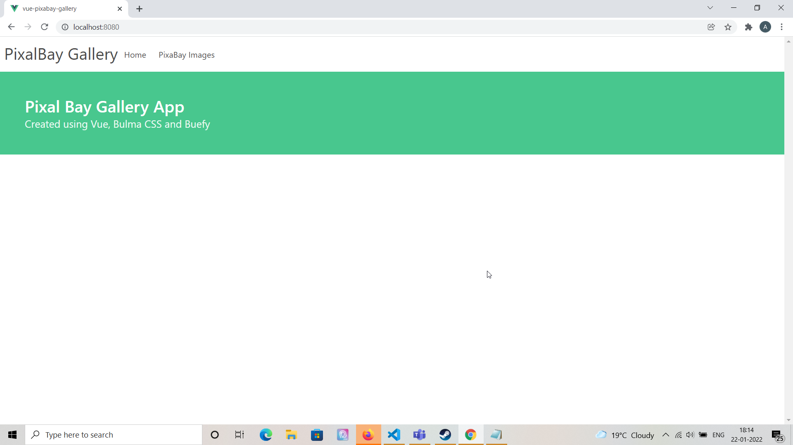
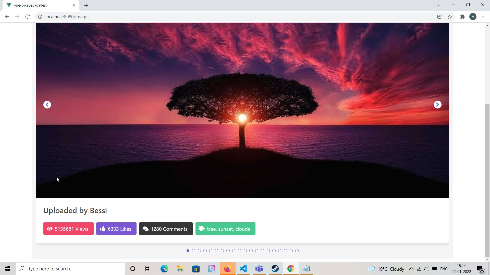
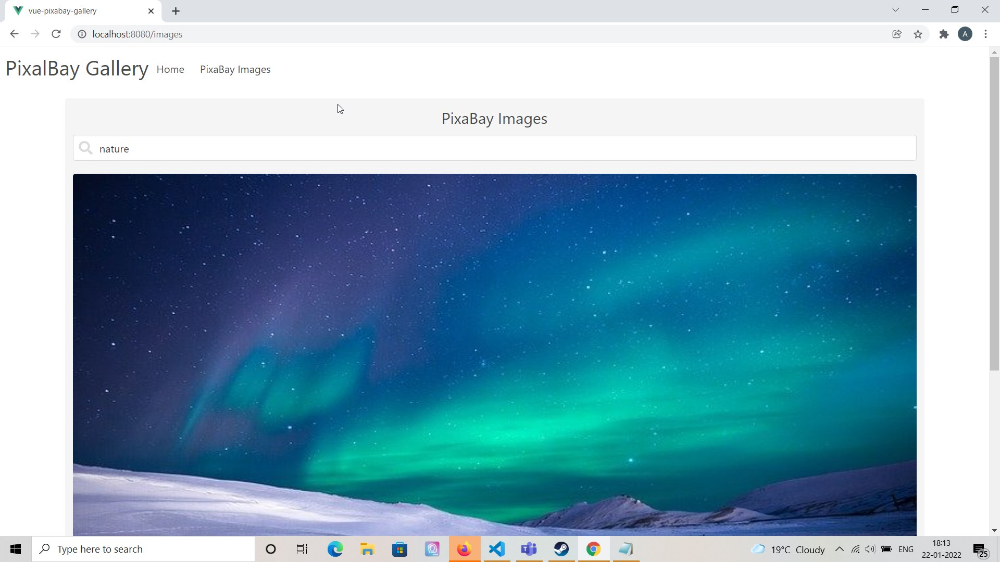
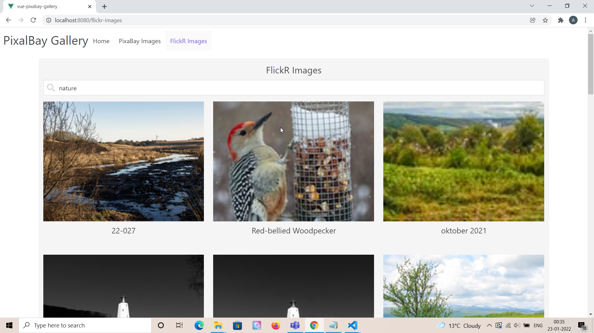

# PixaBay Gallery in Vue

<p align="center">
  <a href="https://vuejs.org/"></a>
  <a href="https://vite.dev/"></a>
  <a href="https://tailwindcss.com/"></a>
  <a href="https://pixabay.com/api/docs/"></a>
  <a href="https://axios-http.com/"></a>
  <a href="https://vitest.dev/"></a>
  <a href="https://www.docker.com/"></a>
  <a href="https://nginx.org/"></a>
</p>

## Table of Contents

- [Project Briefing](#project-briefing)
- [Built With](#built-with)
- [Features](#features)
- [Project Structure](#project-structure)
- [Getting Started](#getting-started)
- [Environment Variables](#environment-variables)
- [Available Scripts](#available-scripts)
- [How API Requests Work](#how-api-requests-work)
- [Testing](#testing)
- [Docker](#docker)
- [Deployment](#deployment)
- [Screenshots](#screenshots)
- [Future Improvements](#future-improvements)
- [Author](#author)
- [License](#license)

## Project Briefing

A responsive image gallery built with Vue 3 and styled with Tailwind CSS. Images are fetched from the [Pixabay API](https://pixabay.com/api/docs/), which is free for limited usage. The app supports keyword search, page transitions between routes and a mobile friendly layout.

## Built With

| Technology | Purpose |
| --- | --- |
| [Vue 3](https://vuejs.org/) | UI framework (Composition API, `<script setup>`) |
| [Vue Router](https://router.vuejs.org/) | Client side routing with lazy loaded screens |
| [Vite](https://vite.dev/) | Dev server and build tool |
| [Tailwind CSS 4](https://tailwindcss.com/) | Utility-first styling via `@tailwindcss/vite` |
| [Pixabay API](https://pixabay.com/api/docs/) | Source of images |
| [Axios](https://axios-http.com/) | HTTP client with a shared instance in `src/plugins/interceptor.js` |
| [Swiper](https://swiperjs.com/) | Carousel / slider |
| [Headless UI](https://headlessui.com/) and [Heroicons](https://heroicons.com/) | Accessible components and icons |
| [AOS](https://michalsnik.github.io/aos/) | Scroll animations |
| [Fuse.js](https://www.fusejs.io/) | Fuzzy search |
| [Day.js](https://day.js.org/) | Date formatting |
| [AG Grid](https://www.ag-grid.com/) | Data grid |
| [Vitest](https://vitest.dev/), [Vue Test Utils](https://test-utils.vuejs.org/) and [happy-dom](https://github.com/capricorn86/happy-dom) | Unit testing |
| [Docker](https://www.docker.com/) and [Nginx](https://nginx.org/) | Production container |

## Features

- Search Pixabay images by keyword.
- Home, About and Pixabay gallery screens, with a catch-all 404 page.
- Animated slide transition between routes.
- Lazy loaded routes for faster initial load.
- Loader component while images are being fetched.
- Responsive header and footer.
- Dev proxy that keeps the API key out of the browser.
- Multi-stage Dockerfile and Vercel configuration.

## Project Structure

```
.
├── Dockerfile
├── nginx.conf
├── vercel.json
├── vite.config.js
├── index.html
├── public/
├── screenshots/
└── src/
    ├── App.vue                 # Layout and route transition
    ├── main.js                 # App bootstrap
    ├── style.css               # Tailwind entry and theme
    ├── components/             # Header, Footer, Loader
    ├── composables/            # Reusable logic (useDinosaur)
    ├── plugins/interceptor.js  # Axios instance
    ├── routes/index.js         # Route definitions
    ├── screens/                # Home, About, Pixabay, 404
    └── __tests__/              # Vitest suites
```

## Getting Started

### Prerequisites

- Node.js 20 or newer
- npm
- A free API key from [Pixabay](https://pixabay.com/api/docs/)

### Installation

```bash
git clone <repository-url>
cd pixabay-gallery-in-vue-and-buefy
npm install
```

Create a `.env` file in the project root (see below), then start the dev server:

```bash
npm run dev
```

The app runs at http://localhost:8080.

## Environment Variables

Create a `.env` file in the project root:

```
PIXABAY_KEY=your_pixabay_api_key
```

`VITE_PIXABAY_KEY` is also accepted. The key is read in `vite.config.js` and appended by the dev server proxy. Pixabay limits usage to roughly 100 requests per minute, which is enough for educational and experimental use. Never commit your `.env` file.

## Available Scripts

| Command | Description |
| --- | --- |
| `npm run dev` | Start the Vite dev server on port 8080 |
| `npm run build` | Create a production build in `dist/` |
| `npm run preview` | Preview the production build locally |
| `npm test` | Run the Vitest test suite |

## How API Requests Work

- In development, requests go to `/api/pixabay/`. The Vite proxy forwards them to `https://pixabay.com/api/` and injects the API key from your environment.
- In production builds, the Axios instance targets `https://pixabay.com/api/` directly. Make sure your deployment supplies the key in a way that does not expose secrets you are not willing to make public, for example through a server-side proxy.

## Testing

Tests live in `src/__tests__/` and cover the 404 screen, header, footer and the `useDinosaur` composable.

```bash
npm test
```

## Docker

The Dockerfile builds the app with Node and serves the static output with Nginx.

```bash
docker build -t pixabay-gallery .
docker run -p 8080:80 pixabay-gallery
```

## Deployment

A `vercel.json` is included for deploying to Vercel, and `nginx.conf` handles SPA fallback routing for the Docker image.

## Screenshots

Homepage:



Images page:



Search bar and results:



Additional gallery view:



## Future Improvements

- Pagination for search results.
- Server-side proxy for production API key handling.
- More test coverage for screens and the API layer.

## Author

**Amit Prafulla (APFirebolt)** - https://apgiiit.com/

## License

See [LICENSE.md](./LICENSE.md).
